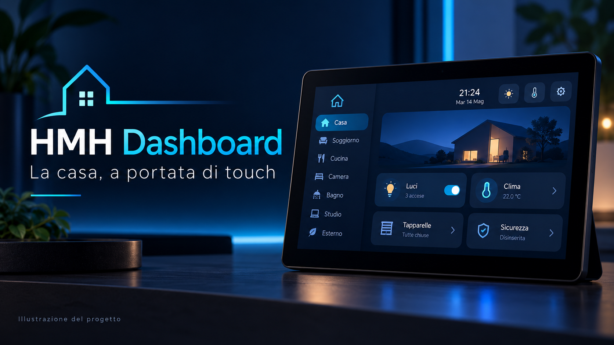

# HMH Dashboard



Dashboard touch per Home Assistant con ESPHome e LVGL, con interfaccia condivisa tra **Sunton ESP32-8048S070** e **Waveshare ESP32-S3-Touch-LCD-7 V1 (800×480)**.
Le stanze e le entità vengono costruite dinamicamente dal catalogo Home Assistant.

> Il banner è un'illustrazione generata con AI: non è una foto del dispositivo né uno screenshot della GUI effettiva.

## Funzioni

- Stanze, dispositivi e chip selezionati tramite etichette Home Assistant.
- Controlli per luci, interruttori, clima, tapparelle, ventilatori e altri domini supportati.
- Navigazione touch, ordinamento e impostazioni dell'interfaccia.
- Standby con ora, data, meteo, sfondo e prossimo evento.
- Calendario mensile con indicazione dei giorni con eventi e selezione del giorno.
- Pagine energia e storico sensori collegate al componente Home Assistant.
- Configurazione comune e file hardware separati.


## Hardware e link affiliato

| Configurazione | Display |
| --- | --- |
| `HA_Dashboard_Sunton.yaml` | Sunton ESP32-8048S070 |
| `HA_Dashboard_Waveshare.yaml` | Waveshare ESP32-S3-Touch-LCD-7 V1, 800×480 |

- **[Amazon — link affiliato HackMyHome](https://link.amazon/B0hEK8Jso)**
- **[Waveshare ESP32-S3-Touch-LCD-7 — link affiliato HackMyHome](https://www.waveshare.com/product/esp32-related/boards-kits/esp32-s3/esp32-s3-touch-lcd-7.htm?aff_id=HackMyHome)**

I collegamenti sono affiliati. Verifica modello e variante nella scheda prodotto prima dell'acquisto.

## Struttura

- `esphome/`: i due file principali, `common.yaml`, file hardware, `room_sidebar.h` e font.
- `home_assistant/custom_components/hmh_dashboard/`: integrazione custom per il catalogo e lo storico.
- `home_assistant/packages/`: catalogo, sfondo e calendario.
- `docs/images/`: immagini per la documentazione.

## Installazione Home Assistant

1. Copiare `home_assistant/custom_components/hmh_dashboard` in `/config/custom_components/hmh_dashboard`.
2. Copiare i tre file di `home_assistant/packages/` in `/config/packages/`.
3. Abilitare i package in `configuration.yaml`, integrando la voce nell'eventuale sezione `homeassistant` già presente:

```yaml
homeassistant:
  packages: !include_dir_named packages
```

4. Controllare la configurazione e riavviare Home Assistant.
5. Assegnare le entità alle aree e applicare le etichette sotto indicate.

| Etichetta | Utilizzo |
| --- | --- |
| `HMH Dashboard` | Entità da visualizzare nella dashboard |
| `HMH Dashboard Chip` | Entità da visualizzare come chip |
| `HMH Dashboard Sfondo` | Entità `image.*` per lo sfondo standby |
| `HMH Dashboard Calendario` | Una o più entità `calendar.*` |

Il package catalogo conserva `label: "HA Dashboard"` dalla configurazione installata; la selezione delle entità nel componente corrente usa il nome **HMH Dashboard**. Non aggiungere spazi doppi nelle etichette.

## Installazione ESPHome

1. Copiare il contenuto di `esphome/` in `/config/esphome/`, mantenendo la cartella `fonts/`.
2. Integrare nel proprio `secrets.yaml` i campi di `secrets.yaml.example`. Non sostituire un file di segreti già utilizzato da altri dispositivi.
3. Configurare gli IP nei due file principali, gateway/subnet nei file hardware e `ha_base_url` in `common.yaml`. Gli indirizzi inclusi sono quelli della configurazione di origine e vanno adattati alla propria rete.
4. Usare la chiave API già associata ai display, oppure configurare una nuova chiave valida e aggiornare l'integrazione ESPHome in Home Assistant.
5. Per aggiornare un display già installato, mantenere in `ota_password` la sua password OTA corrente. Il file Sunton pubblicato usa un riferimento a un segreto al posto della password originale.
6. Compilare e installare il file principale del proprio hardware. Non installare direttamente `common.yaml` o `hardware_*.yaml`.
7. Aggiungere il dispositivo all'integrazione ESPHome e consentire al dispositivo di eseguire azioni Home Assistant nelle relative opzioni.

I nomi predefiniti sono `sunton-7` e `hmh-waveshare-7`. Se vengono cambiati, aggiornare anche le condizioni e le azioni `esphome.*_calendar_payload` nel package calendario.

## Stato della versione importata

Importazione dei sorgenti forniti il 17 ottobre 2026, con data e prossimo evento dello standby in **bianco**.

Il file Waveshare include una **prova a 12 MHz** per ridurre le righette intermittenti, rispetto ai 16 MHz del preset. Il refresh teorico scende da circa 38 a 28 Hz. La risoluzione del flickering non è ancora confermata sul dispositivo. Per tornare al preset rimuovere `pclk_frequency: 12MHz`, poi ricompilare e installare.

Validazione YAML ESPHome eseguita con **2026.9.1**. La validazione della configurazione non equivale a compilazione completa o collaudo hardware. Per Home Assistant vengono controllate sintassi Python e YAML; è necessario verificare il funzionamento sulla propria istanza.

Le funzionalità hardware dipendono dal modello: sul Waveshare V1 la luminosità esposta è virtuale, come indicato nel file hardware.

## Immagini e font

Il banner è stato creato con ImageGen; lo schema è un SVG della struttura del progetto. Prompt del banner e provenienza sono in [docs/immagini.md](docs/immagini.md).
I font provengono dall'archivio del progetto fornito dall'autore. Le rispettive licenze restano applicabili; questa importazione non assegna una nuova licenza ai font o al codice.
