# Guida pratica a HMH Dashboard

[Torna alla presentazione e all'installazione](../README.md)

Questa guida descrive l'uso della versione multi-hardware per Sunton e Waveshare dopo l'installazione. Le impostazioni dell'interfaccia vengono gestite dal singolo display.

> Le immagini sono quelle preparate per il video e fornite dall'autore. Nomi, valori e alcuni dettagli grafici possono differire dalla configurazione e dalla versione installata.

## 1. Come arrivano i dati al display

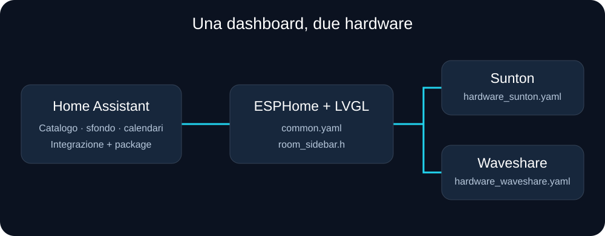

Home Assistant fornisce aree, entità e stati attraverso l'integrazione HMH Dashboard. Il display costruisce l'interfaccia usando il catalogo ricevuto. Per aggiungere una normale entità supportata non occorre riscrivere la pagina LVGL o ricompilare il firmware: si lavora sulle etichette e sulle aree in Home Assistant.

## 2. Aggiungere la temperatura media di casa

1. In Home Assistant individua l'entità che contiene la temperatura media. Deve esistere già: la dashboard visualizza il valore, non calcola automaticamente la media.
2. Apri le impostazioni dell'entità e assegnale l'etichetta **HMH Dashboard**.
3. Assegna l'entità a un'area, oppure verifica l'area del dispositivo a cui appartiene.
4. Sul display seleziona l'area corrispondente e attendi l'aggiornamento del catalogo.
5. Il sensore compare con nome, valore e unità di misura disponibili in Home Assistant.

Per togliere l'entità dalla dashboard, rimuovi l'etichetta. Non è necessario cancellare l'entità da Home Assistant.

**Attenzione al nome:** usa `HMH Dashboard`, con uno spazio tra le parole. La selezione del componente corrente usa questo nome anche se nel package storico compare `label: "HA Dashboard"`.

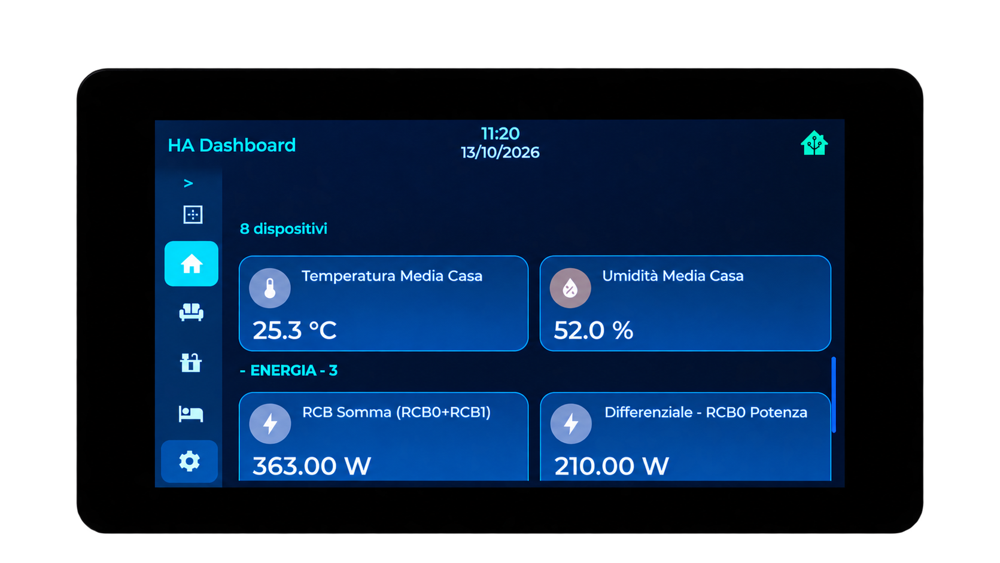

*Esempio del risultato: il sensore etichettato viene visualizzato tra le entità della stanza.*

## 3. Scegliere e ordinare le stanze

Apri **Impostazioni → Stanze** sul display.

- Seleziona le caselle delle stanze che vuoi mostrare.
- Deseleziona quelle da nascondere.
- Tieni premuto il nome della stanza, trascinalo nella posizione desiderata e rilascia.
- Premi **Salva** per applicare le modifiche, oppure **Annulla** per scartarle.

Nascondere una stanza cambia soltanto la visualizzazione sul display. Le entità continuano a esistere e a funzionare in Home Assistant.

## 4. Passare da una stanza all'altra e cambiare pagina

Tocca il nome della stanza nella barra laterale per vedere i suoi dispositivi.

Per cambiare pagina, scorri orizzontalmente nella zona di navigazione dell'interfaccia. Evita di iniziare il gesto sopra slider o chip: questi elementi gestiscono il proprio tocco. Anche un dettaglio aperto, le impostazioni o un trascinamento possono impedire il cambio pagina.

Le pagine della versione pubblicata seguono questo ordine:

1. Stanze.
2. Categorie.
3. Batterie.
4. Energia.
5. Calendario, quando abilitato.

I puntini di navigazione compaiono temporaneamente per indicare la pagina selezionata.

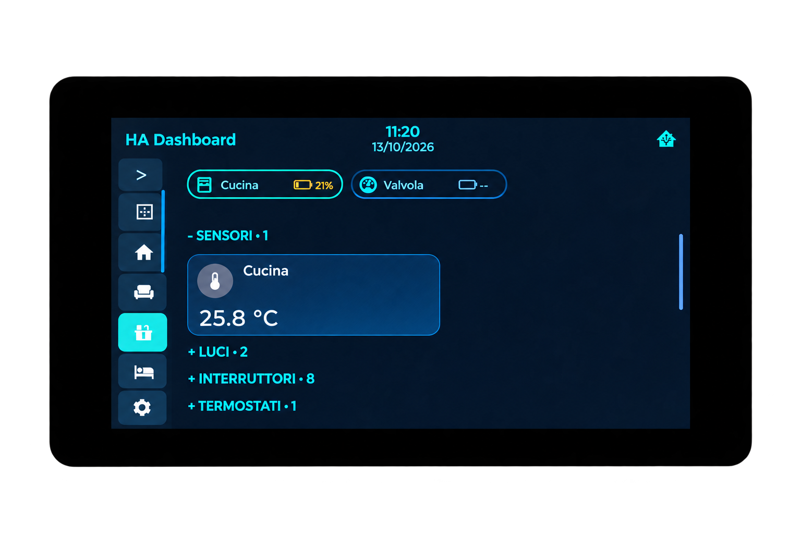

*La stanza selezionata è evidenziata nella barra laterale.*

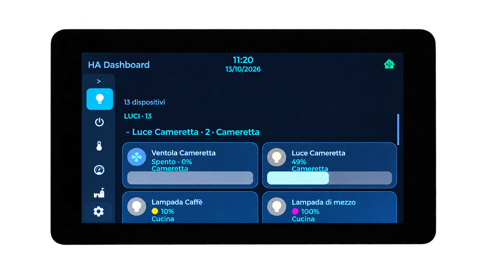

*La pagina Categorie raccoglie entità dello stesso tipo, anche di stanze diverse.*

### Controllare le batterie

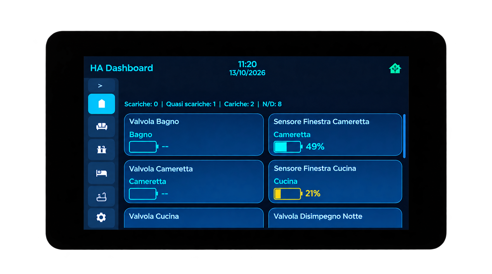

La pagina Batterie riporta i livelli disponibili. Un trattino o N/D indica che il valore non è disponibile, non che la batteria sia scarica.

## 5. Spostare i widget

1. Apri la stanza interessata.
2. Tieni premuto **il nome o l'icona** del widget.
3. Attendi l'avvio del trascinamento.
4. Sposta il widget e osserva l'indicatore della posizione di inserimento.
5. Rilascia per completare lo spostamento.

Il codice gestisce anche il trascinamento delle intestazioni di gruppo. Usa nome o icona per riordinare un widget: i pulsanti e gli slider servono invece a comandare il dispositivo.

## 6. Usare i controlli

I controlli disponibili dipendono dal dominio e dalle capacità esposte dall'entità.

| Elemento | Uso |
| --- | --- |
| Luci e interruttori | Usa i comandi presenti nella scheda; per le luci compatibili sono disponibili regolazioni aggiuntive. |
| Clima | Modifica la temperatura e usa le modalità offerte dal dispositivo. |
| Tapparelle | Usa apertura, chiusura e arresto. |
| Ventilatori | Usa i controlli disponibili, inclusa la velocità se supportata. |
| Sensori | Leggi il valore; tocca nome o icona per aprire lo storico. |

Perché i comandi funzionino, il display deve essere connesso a Home Assistant e autorizzato a eseguirne le azioni nelle opzioni dell'integrazione ESPHome.

### Esempio: luce RGB

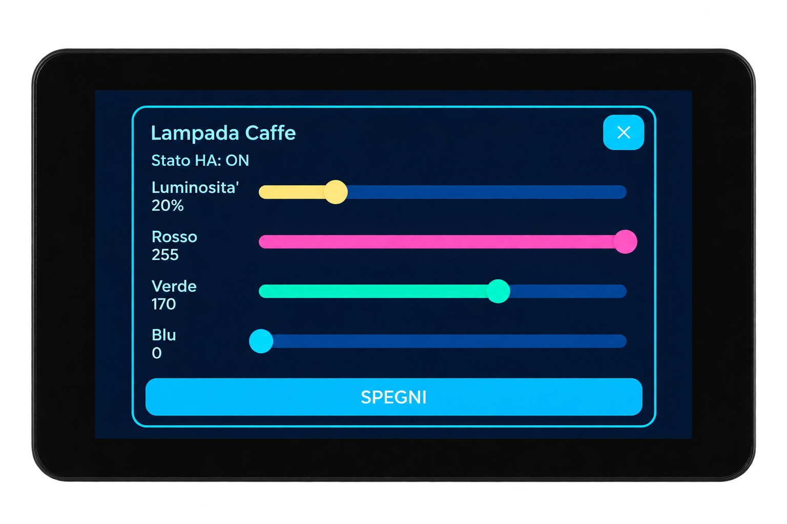

*Esempio del pannello di una luce compatibile: luminosità, canali RGB e comando di spegnimento.*

### Esempio: antifurto e PIN

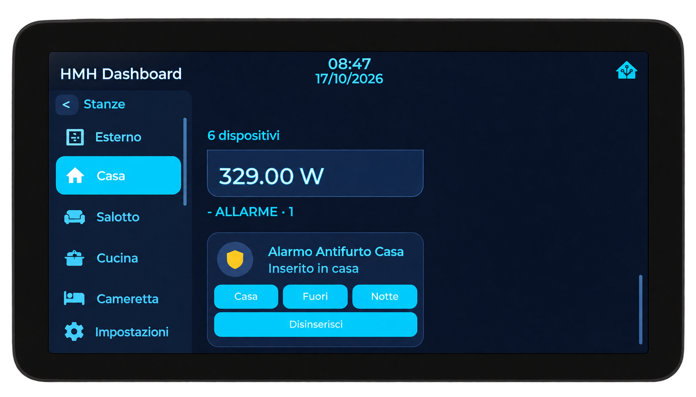

Usa i comandi della scheda per richiedere una modalità supportata dall'allarme o il disinserimento. Lo stato visualizzato proviene da Home Assistant.

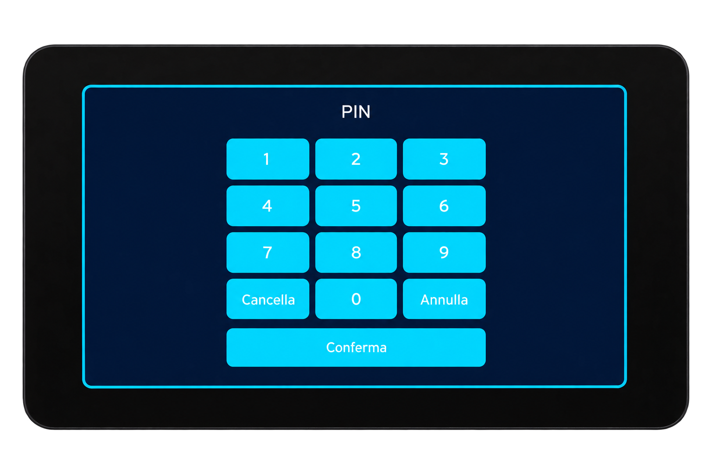

Quando viene richiesto un codice, inseriscilo sul tastierino e premi **Conferma**; **Annulla** chiude la richiesta. Il codice deve essere quello previsto dall'integrazione dell'allarme.

### Esempio: purificatori

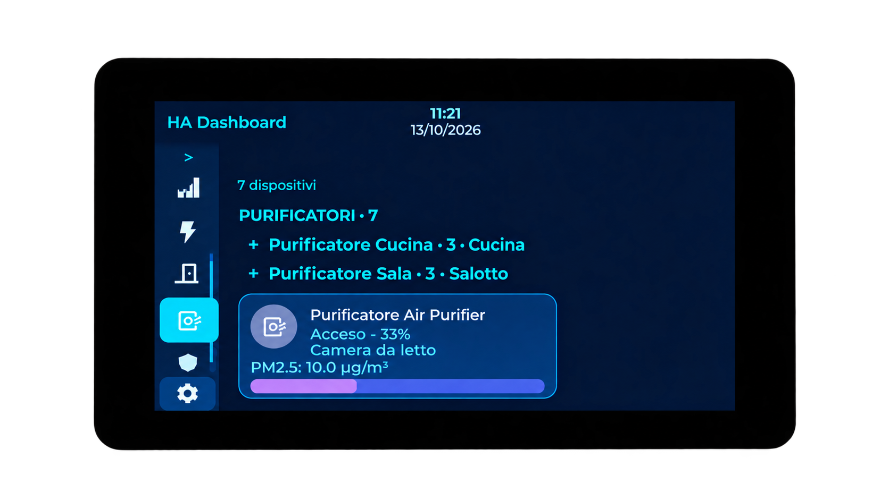

*Esempio di gruppo con stato, velocità e misura PM2.5, quando disponibili dalle entità collegate.*

## 7. Aggiungere i chip

Assegna l'etichetta **HMH Dashboard Chip** direttamente alle entità da mostrare come chip. Verifica anche la loro area.

Un esempio è il sensore di una finestra: il chip permette di controllarne lo stato insieme alle altre informazioni della stanza. L'aspetto dipende dal tipo di entità.

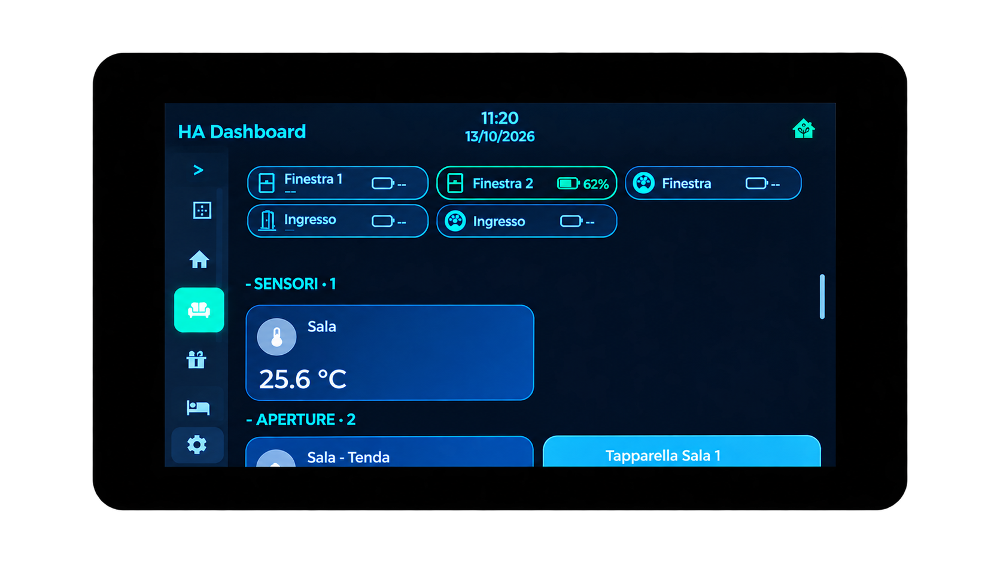

*I chip raccolgono le informazioni compatte sopra i widget della stanza.*

## 8. Configurare il calendario

1. Verifica che i calendari siano già presenti in Home Assistant come entità `calendar.*`.
2. Applica **HMH Dashboard Calendario** a uno o più calendari.
3. Attendi l'aggiornamento: il sensore che abilita la pagina controlla le etichette ogni minuto.
4. Raggiungi la pagina Calendario.
5. Tocca un giorno per aggiornare l'elenco degli appuntamenti; la stellina segnala i giorni con eventi.
6. Usa le frecce per cambiare mese e **Oggi** per tornare alla data corrente.

Gli eventi vengono letti tramite `calendar.get_events`. Il solo stato acceso/spento dell'entità calendario non contiene l'intero elenco.

Se hai rinominato i nodi ESPHome, aggiorna nel package calendario sia i nomi dei dispositivi sia le azioni di risposta. I nomi predefiniti sono `sunton-7` e `hmh-waveshare-7`.

## 9. Standby e immagine di sfondo

Dopo **60 secondi senza interazione**, il display entra in standby. Un tocco lo risveglia.

Lo standby mostra ora, data e, quando disponibili, meteo e prossimo evento. Data e prossimo evento sono bianchi nella versione pubblicata.

Per lo sfondo:

1. Individua un'entità Home Assistant `image.*` con un'immagine disponibile.
2. Assegna direttamente a quell'entità l'etichetta **HMH Dashboard Sfondo**.
3. Verifica che il display possa raggiungere Home Assistant all'indirizzo `ha_base_url`.
4. Attendi l'aggiornamento del package e il download dell'immagine.

Per una scelta univoca, applica l'etichetta a una sola immagine. Il package cerca le entità etichettate in ordine alfabetico e usa la prima immagine disponibile con un URL valido. Un semplice percorso a un file non sostituisce l'entità `image.*`.

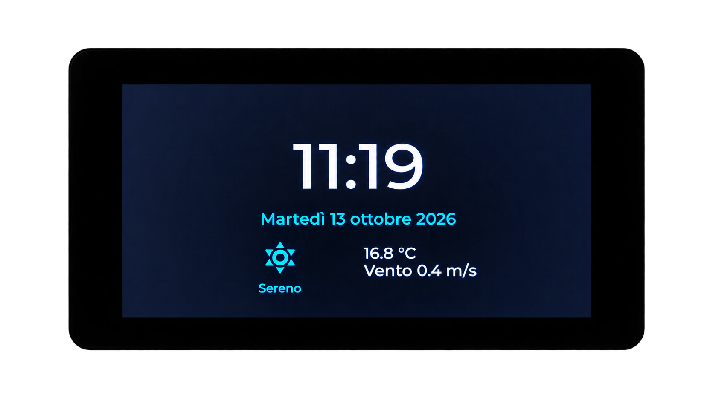

*Immagine del video precedente alla modifica del colore: nella versione attuale data e prossimo evento sono bianchi. Questo esempio non mostra uno sfondo personalizzato né un evento.*

## 10. Tema e luminosità notturna

In **Impostazioni → Aspetto** scegli **Chiaro**, **Scuro** o **Auto**, poi premi **Salva**.

- Auto usa il tema scuro dalle **20:00 alle 07:00**.
- La luminosità notturna è prevista dalle **22:00 alle 07:00**, durante lo standby.
- I livelli selezionabili sono 55%, 70%, 85% e 100%.

Sul **Waveshare V1**, il controllo della luminosità nella configurazione pubblicata è virtuale: non regola fisicamente la retroilluminazione. Il comportamento dipende dall'hardware.

## 11. Energia e storico

Per lo storico di un sensore, tocca il suo nome o la sua icona. Sono necessari dati registrati da Home Assistant Recorder; un sensore appena creato potrebbe non avere ancora campioni sufficienti.

La pagina Energia permette di cambiare giorno e tornare a **Oggi**. Le serie disponibili dipendono dai sensori e dai dati registrati.

I ruoli energetici previsti sono:

- `HMH Dashboard Energia Ingresso`
- `HMH Dashboard Energia Produzione`
- `HMH Dashboard Energia Immissione`
- `HMH Dashboard Energia Carica`
- `HMH Dashboard Energia Scarica`

Assegna un solo ruolo energetico a ciascun sensore. Usa sensori con unità coerenti di potenza o energia. Se lo storico presenta intervalli mancanti, questi non devono essere interpretati automaticamente come consumo zero.

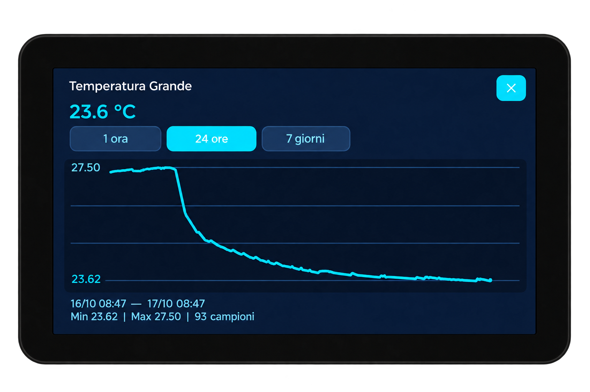

*Esempio di storico: selezione del periodo, grafico, minimo, massimo e numero di campioni.*

## 12. Se qualcosa non compare

| Problema | Controllo |
| --- | --- |
| Entità assente | Etichetta esatta, dominio supportato, area e disponibilità dell'entità. |
| Stanza assente | Selezione in Impostazioni → Stanze e salvataggio. |
| Catalogo non aggiornato | Presenza e attributi di `sensor.ha_dashboard_catalog`; integrazione custom caricata. |
| Comando senza effetto | Connessione API e autorizzazione alle azioni Home Assistant. |
| Calendario assente | Etichetta sulle entità `calendar.*`, package installato e aggiornamento del sensore di stato. |
| Calendario vuoto | Eventi nel periodo selezionato e corrispondenza dei nomi ESPHome nel package. |
| Sfondo assente | Entità `image.*` disponibile, attributo `entity_picture` e URL raggiungibile dal display. |
| Storico vuoto | Registrazione Recorder e presenza di campioni per il periodo. |
| Righette sul Waveshare | La versione include la prova a 12 MHz descritta nel README; l'esito sul dispositivo è ancora da confermare. |

---

Guida basata sui sorgenti importati nel repository e illustrata con una selezione delle immagini preparate per il video. Le immagini non raffigurano ogni gesto descritto: i passaggi senza immagine restano spiegati nel testo.
